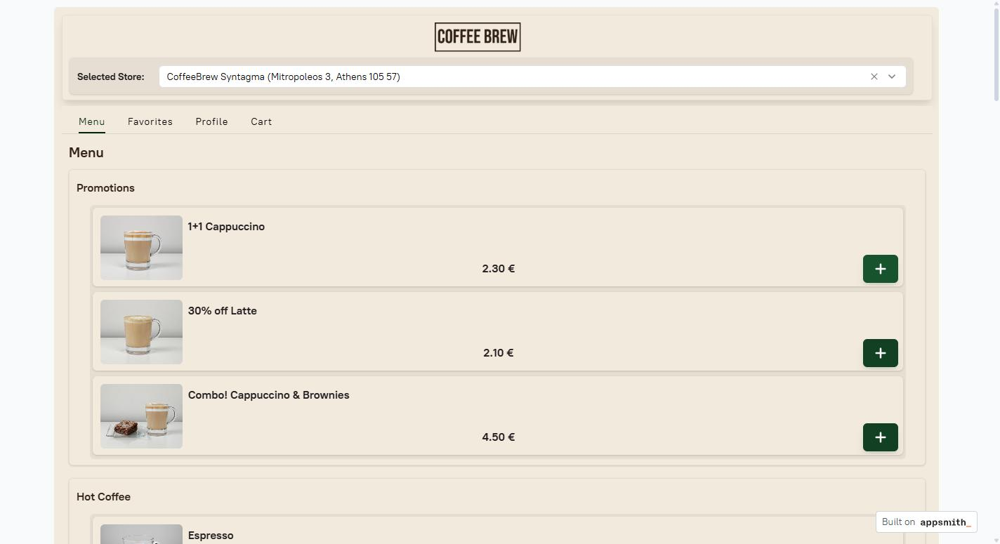
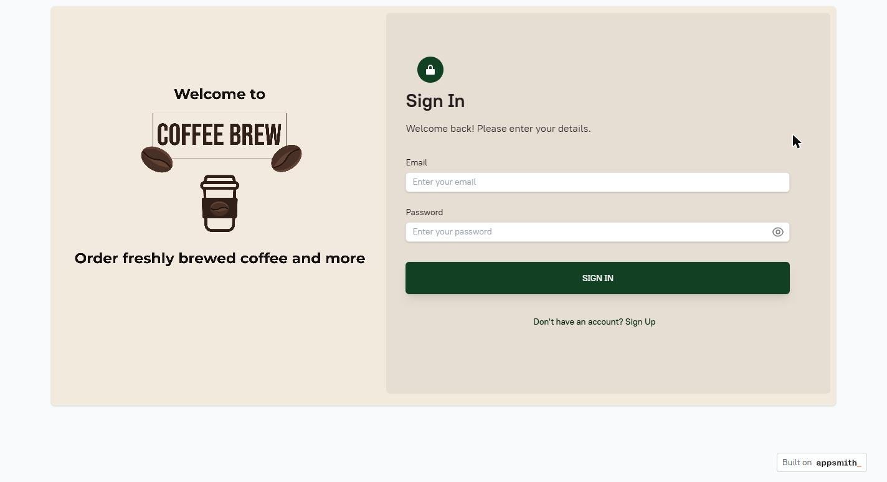
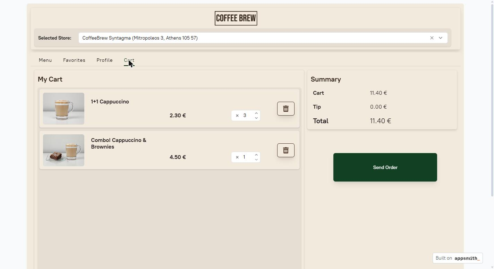
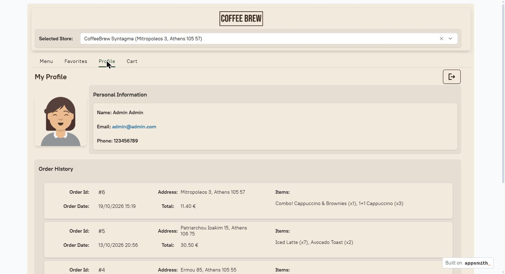
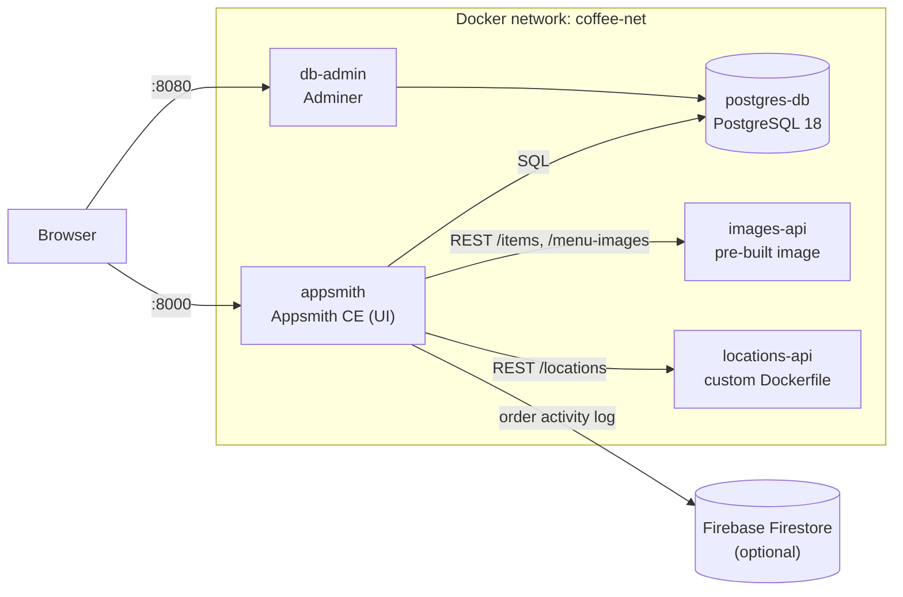

# Coffee Brew

A containerised coffee-ordering app: a low-code Appsmith front end on top of
PostgreSQL and two small REST microservices, all orchestrated with Docker Compose,
with optional activity logging to a serverless cloud database (Firebase Firestore).



## What it does

Customers sign up or sign in, pick one of the chain's coffee shops, and browse a
menu of coffees, teas, juices and snacks, each with a photo. They can save items
as favourites, build a cart and adjust quantities, and send the order. Their
profile page shows their details and full order history. Every submitted order can
also be logged to Firestore, so customer activity is recorded in a cloud database
alongside the local one.

The point of the project is the architecture rather than the UI: each concern runs
in its own container, the containers find each other by service name on a private
Docker network, and the whole system comes up with one command.

## Screenshots

| Sign in | Cart |
| --- | --- |
|  |  |


*The profile page: customer details and order history, read from PostgreSQL.*

## Features

- **Accounts:** sign-up and sign-in, with passwords stored as bcrypt hashes.
- **Shop selection:** shop list and coordinates served by the locations microservice.
- **Menu:** 29 items in 8 categories, including promotions, with photos served by the
  images microservice.
- **Favourites, cart and orders:** favourites, a cart with editable quantities, and
  order submission with order history, all persisted in PostgreSQL.
- **Cloud activity log (optional):** each order is written to Firestore as a `logs`
  document.
- **Seeded demo data:** a demo account with favourites and past orders, loaded on
  first start.

## Architecture



| Service | Image | Host port | Role |
| --- | --- | --- | --- |
| `appsmith` | `appsmith/appsmith-ce:v1.95` | 8000 | The low-code UI and its JS/query logic |
| `postgres-db` | `postgres:18.6` | 5432 | Customers, menu, favourites, orders |
| `images-api` | `svenwal/jsonplaceholder:1.1` | 3000 | Menu item list and the photos as static files |
| `locations-api` | built from `REST-APIs/locations.Dockerfile` | 3001 | Shop list with addresses and coordinates |
| `db-admin` | `adminer:5.5.1` | 8080 | Web UI for inspecting the database |

The setup covers these Docker and microservice patterns:

- **Two ways to ship a microservice.** `images-api` is a pre-built image configured
  only through mounted files: its data file and the photo folder. `locations-api` is
  built from a custom Dockerfile that installs `json-server` on a Node base image.
- **Service discovery by name.** Containers talk to each other over the `coffee-net`
  network using their service names (`postgres-db:5432`, `images-api:3000`), never
  host ports.
- **Startup ordering.** PostgreSQL has a `pg_isready` healthcheck, and Appsmith and
  Adminer start only once it reports healthy.
- **Persistence and seeding.** The database lives in the `coffee-data` volume. On
  first start, `seed-db.sql` is run from `docker-entrypoint-initdb.d` to create the
  schema and demo data.
- **Configuration outside the code.** Credentials come from a `.env` file that is
  not committed.
- **Local plus serverless storage.** Transactional data stays in PostgreSQL, while
  activity logs go to Firestore, a managed cloud database.

## Tech stack

Docker Compose · Appsmith CE · PostgreSQL 18 · json-server · Node.js · Adminer ·
Firebase Firestore · bcrypt.js

## Getting started

### Prerequisites

- Docker and Docker Compose
- Optional: a Firebase project, for the Firestore activity log

### Configure

```bash
cp example.env .env
```

Then edit `.env` and choose a database password:

```
POSTGRES_DB=postgres
POSTGRES_USER=postgres
POSTGRES_PASSWORD=<choose-a-password>
```

### Run

```bash
docker compose up --build -d
```

Appsmith takes two to three minutes to start the first time. It is ready when
http://localhost:8000 shows the Appsmith setup page.

### Import the app into Appsmith

The UI is an Appsmith application export (`coffee_brew_appsmith.json`), so it has to
be imported once:

1. Open http://localhost:8000 and create the local Appsmith admin account. Any email
   and password work, since the account exists only in your container.
2. On the workspace page, choose **Create new → Import → Import from file**, and
   select `coffee_brew_appsmith.json`.
3. Appsmith asks you to reconnect the datasources. Exports never include credentials.

   | Datasource | Settings |
   | --- | --- |
   | **PostgresDB** | Host `postgres-db`, port `5432`, database `postgres`, username `postgres`, password: the one from your `.env` |
   | **images-api** | URL `http://images-api:3000` (prefilled) |
   | **locations-api** | URL `http://locations-api:3000/locations` (prefilled) |
   | **Firestore** | Optional, see [Firestore activity log](#firestore-activity-log-optional). Leave it unconfigured to skip it. |

   If **Save** stays greyed out on a prefilled REST datasource, change any field
   (for example, tick and untick a checkbox) to enable it.
4. Click **Go to application**, then **Deploy** in the top-right corner.

### Use it

Sign in with the seeded demo account, or sign up as a new customer:

- **Email:** `admin@admin.com`
- **Password:** `12345`

Adminer is at http://localhost:8080 (System `PostgreSQL`, server `postgres-db`, plus
the credentials from `.env`).

### Stop

```bash
docker compose down
```

To stop **and wipe the database**, so that it is re-created and re-seeded on the next
`up`:

```bash
docker compose down -v
```

PostgreSQL reads `POSTGRES_PASSWORD` and runs the seed script only when its volume is
empty. If you change either of them, run `down -v` for the change to take effect.
The Appsmith instance (your admin account and the imported app) lives in the
`stacks/` folder. Delete that folder to reset Appsmith as well.

### Firestore activity log (optional)

Without Firestore, everything works: orders are saved to PostgreSQL and only the
cloud log is skipped. To enable it:

1. Create a Firebase project and a Firestore database in it.
2. Under **Project settings → Service accounts**, generate a new private key, which
   downloads a JSON file. Keep it out of the repository: `firestore_creds.json` is
   already in `.gitignore`.
3. In Appsmith, open the **Firestore** datasource and set:
   - **Database URL:** `https://<your-project-id>.firebaseio.com`
   - **Project Id:** your project id
   - **Service account credentials:** the contents of the JSON file

Each submitted order then creates a document in the `logs` collection, with the
customer, the action (`ORDER_SUBMITTED`), the cart total and a `created_at`
timestamp.

## Notes

- The shop map uses Appsmith's map widget, which needs a map provider API key. None
  is configured, so the map shows placeholder tiles, but the shop markers still
  appear.
- Authentication is handled inside the Appsmith app: the password hash is checked
  with bcrypt.js in the browser session. That is fine for a demo, but a production
  system would verify credentials in a backend service.

## Project structure

```
.
├── compose.yaml                 # The five services, network and volume
├── example.env                  # Template for the local .env
├── seed-db.sql                  # Schema and demo data, run on first start
├── coffee_brew_appsmith.json    # Appsmith application export (the UI)
├── REST-APIs/
│   ├── images-svenwal.json      # Data for images-api
│   ├── menu-images/             # Menu photos served by images-api
│   ├── locations-json-server.json
│   └── locations.Dockerfile     # Custom image for locations-api
└── docs/images/                 # README screenshots
```

## Credits

- UI built with [Appsmith](https://www.appsmith.com/) Community Edition.
- Mock REST APIs powered by [json-server](https://github.com/typicode/json-server)
  and the [svenwal/jsonplaceholder](https://hub.docker.com/r/svenwal/jsonplaceholder)
  image.
- Database admin UI by [Adminer](https://www.adminer.org/).
- Password hashing with [bcrypt.js](https://github.com/dcodeIO/bcrypt.js).
- Map tiles: © [OpenStreetMap](https://www.openstreetmap.org/copyright) contributors, © [CARTO](https://carto.com/attributions).
- Activity log on [Firebase Firestore](https://firebase.google.com/products/firestore).

This project is not affiliated with or endorsed by any of them. Their software and
services remain with their owners and are not covered by the MIT license.

## License

Released under the [MIT License](LICENSE). The menu photos in `REST-APIs/menu-images/`
and the graphics in the Appsmith app (logo, illustrations, avatar) are original or
AI-generated for this project and are covered by the same license.
